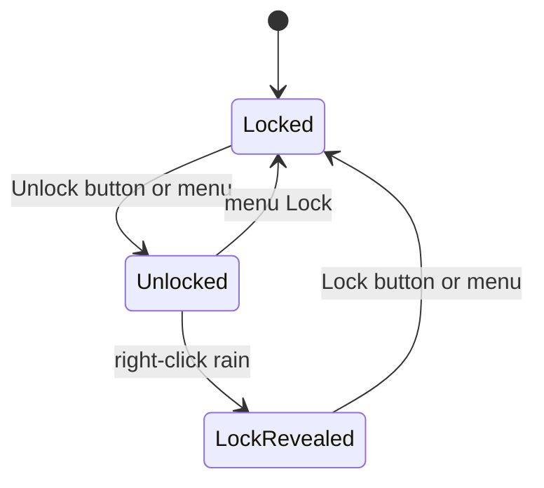
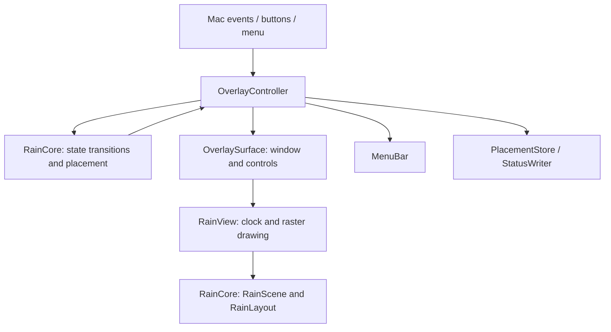

# Matrix Rain — architecture decision v1

4 November 2026. Implements [frozen requirements v1](REQUIREMENTS.md). The domain is one desktop rain overlay, not an institutional workflow or a distributed service.

## Composite approach

| Concern | Chosen approach | Concrete consequence |
| --- | --- | --- |
| Meaning and valid alternatives | Functional domain modeling with Swift value types and associated-value enums | `locked` cannot contain a revealed Lock control. Lock control state belongs to `unlocked`. Persisted rectangles enter through a validated constructor. |
| Interaction lifecycle | Finite-state transitions and unidirectional event flow | UI input becomes an `OverlayEvent`; `OverlayState.applying` returns the next state. Labels and controls are projections of that state. |
| Architecture | Functional core / imperative shell | `RainCore` contains transitions, geometry and simulation. AppKit, clock reads, random seed acquisition, preferences and diagnostics stay in `MatrixRainUI`; `MatrixRain` is the entry point. Swift Package Manager enforces the dependency direction. |
| Native integration | Object-oriented composition and AppKit delegation | Small final classes own windows, menu, view and controller lifetime. Callbacks carry domain events, rather than views casting their delegate to the application class. |
| Animation | Value-based deterministic simulation plus cached raster rendering | Time step and seed are explicit. The simulator returns a new scene; the renderer reuses native glyph images. No scene graph framework or entity-component system is needed. |
| Concurrency | Main-actor confinement and bounded timers | Window state and events serialize on AppKit's main thread. There is no shared mutable state across worker threads. Animation targets 30 Hz; hover sampling uses 10 Hz. |
| Verification | Domain invariants plus native adapter checks | Explore reachable interaction states, test invalid placement and restoration, deterministic simulation, actual native button actions, menu labels, keyboard equivalents, window levels and geometry. Keep human clickability evidence separate. |

This adapts the type-first modeling and functional workflows in Scott Wlaschin's *Domain Modeling Made Functional* to Swift. It does not require rewriting a native Mac app in F#. Sources: [publisher's description](https://store.pragprog.com/titles/swdddf/domain-modeling-made-functional/), [publisher's modeling excerpt](https://media.pragprog.com/titles/swdddf/modeling.pdf).

## Interaction model

Hover does not change the interaction mode. It changes pointer region; `showsUnlock` derives from locked + visible + awake + pointer inside. The Lock control is revealed only in the unlocked state, stays revealed when the pointer leaves, and disappears on locking. Hiding resets the mode to locked. Sleep suspends animation and hides controls without changing mode. Waking a hidden app does not make it visible.

The mode enum excludes locked-with-Lock-control structurally. Other invariants, such as hidden implying locked, are enforced by the reducer and tested across every reachable state. Types do not replace validation of saved data or verification of actual macOS behavior.

## Ownership and dependencies

- `RainCore/Overlay.swift`: product vocabulary, events, reducer, presentation decisions.
- `RainCore/Placement.swift`: validated frame, display recovery, size limits and shared bottom-right geometry.
- `RainCore/RainScene.swift`: deterministic simulation, layout and draw-command data.
- `MatrixRainUI/OverlayController.swift`: event dispatch, lifecycle, hover timer, sleep/display observers, placement persistence.
- `MatrixRainUI/OverlaySurface.swift`: borderless native window, in-window Lock button and desktop Unlock panel.
- `MatrixRainUI/RainView.swift`: cached glyphs, rendering and animation timer. It emits an event callback; it does not decide product transitions.
- `MatrixRainUI/MenuBar.swift`: native menu, symmetric labels and commands without shortcuts.
- `MatrixRainUI/Storage.swift`: existing preference format and local diagnostics boundary.
- `MatrixRainUI/MatrixRainApplication.swift`: application composition, delegate lifetime and single-instance startup; `MatrixRain/main.swift` calls its one public entry point.

`RainCore` imports Swift/Foundation/CoreGraphics geometry only. It never reads screen state, current time, mouse position, preferences or randomness from the system. Core Graphics geometry is a platform value dependency, not an AppKit/window-server dependency. A future cross-platform port could replace those geometric value types if needed; doing so now would add needless conversion code.

## Mac-specific decision: separate Unlock panel

The rain must remain below Finder's icon layer and ignore mouse clicks while locked. Its own view therefore cannot reliably provide a clickable Unlock button at that layer. A separate 100 × 32 nonactivating panel presents only the Unlock button just above desktop icons and below ordinary app windows. The rain stays below icons. Hover is sampled from mouse position; no click monitor, event tap, event reposting or extra permission is used.

Unlocked rain receives its own right-click events and shows a normal button inside the view. Both controls use the same shared dimensions and inset. The panel is a native adapter detail; the core only decides whether Unlock should be visible.

## Persistence, effects and recovery

The only product preference is the content rectangle under existing key `overlayContentRect` and domain `local.pac.matrix-rain`. Startup validates and recovers it against current display geometry. Moving/resizing saves it; mode changes preserve it. There is no persisted interaction log, transient button flag, pause setting or unlocked session to replay. Diagnostic JSON is an observation, not the source of truth.

All effects are local: native window/menu changes, timer lifetime, preferences and diagnostic file writes. A failed diagnostic write is logged and does not invent a state transition or stop animation. Explicit shutdown invalidates timers, removes notification observers, saves placement and removes native surfaces. Weak timer/event callbacks avoid retaining controllers through their own callbacks.

No event sourcing, CQRS infrastructure, generic repository layer, service container, external reactive library, background worker, F# runtime or exhaustive interface hierarchy is justified by these requirements. Dependency injection is limited to concrete storage adapters, diagnostic destination and animation seed.

## Engineering baseline and verification limits

Engineering conventions are applied proportionately: validated types, deterministic core, explicit transitions, shared state-derived views and simple mechanisms. This decorative app does not implement institutional decision workflows. No production certification or independent review is claimed.

`zsh test.sh` runs Swift Testing for the core and then `Tests/NativeChecks/main.swift` as a separate synchronous native-adapter executable. On this Mac, the generic Swift Testing/AppKit host ended before reporting a complete result; those runs are not counted as passes. The native checker fails explicitly on an unmet expectation and is never bundled into the application. It can verify button targets and window properties; it does not prove hover usability, desktop click delivery, animation smoothness, battery impact, all Space configurations or long-term stability. Those require actual observation on the running Mac. See [verification record](VERIFICATION.md) for the evidence obtained in this refactor.
