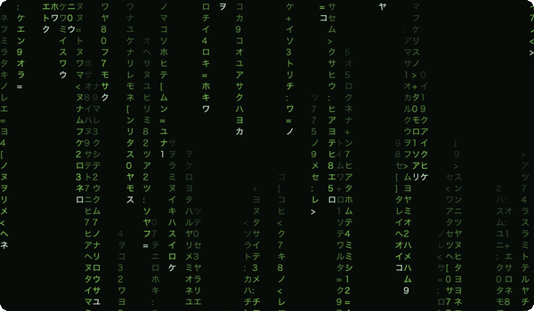

# Matrix Rain



**A little piece of the Matrix for your Mac desktop.**

A native macOS menu bar app with smaller, scalable green digital rain in a borderless window. It preserves your wallpaper and remembers its size and position.

## Use

- **Locked:** the rain sits behind desktop icons and passes clicks through. Hover over it to reveal **Unlock** at the bottom right, then click the button.
- **Unlocked:** drag the rain to move it, or resize its edges and corners. Right-click to reveal **Lock** at the same bottom-right position, then click it.
- **Speed** in the menu bar selects 25%, 50%, 64%, 80%, 100%, 125%, or 200% of the original falling speed. Changes apply immediately and are remembered; the default is 64%.
- The menu bar offers the same **Lock / Unlock** actions, plus **Hide Overlay / Show Overlay** and **Quit Matrix Rain**. Opening the running app again also unlocks it.

There are no title bar, window buttons, keyboard shortcuts, pause control, full-screen, maximize or fill-display commands. The rain always animates while visible and awake; work suspends while hidden or asleep. Reopening the app restores its saved rectangle and starts locked. If a display is disconnected, the window recovers onto an available display.

## Frozen contract and design

- [REQUIREMENTS.md](REQUIREMENTS.md): frozen product requirements v1 and acceptance IDs.
- [ARCHITECTURE.md](ARCHITECTURE.md): the chosen combination of functional domain modeling, state transitions, native object composition and cached rendering.
- [VERIFICATION.md](VERIFICATION.md): executed checks and the limits of the evidence.
- [AGENTS.md](AGENTS.md): maintenance rules for future coding work.

`RainCore` is a deterministic module for interaction, placement and animation. `MatrixRainUI` handles AppKit, clocks and storage. `MatrixRain` is only the entry point. No external packages or network services are required. The app does not request Accessibility or Screen Recording access and does not install itself as a login item.

## Build and verify

The build script targets Apple Silicon and macOS 14 or later, using Swift 6 command-line tools. Verified here with Apple's Swift 6.4.2 tools on macOS 27.2; compatibility with other macOS releases has not been verified.

```sh
zsh test.sh
zsh build.sh
open "build/Matrix Rain.app"
```

`test.sh` uses the selected toolchain's bundled Swift Testing plugin, including a workaround for Command Line Tools versions whose default plugin search misses its testing subdirectory. The tests are separate from the installed application. Domain tests use Swift Testing; native checks run synchronously in their own development executable with explicit failure status. The build script selects only the application product for release.

The release build is optimized and locally ad-hoc signed. It is not notarized for distribution. The installed copy is `~/Applications/Matrix Rain.app`; close the app before replacing it with a new build. Build artifacts stay in the local `build/` directory.

## Storage and recovery

The bundle/preferences identity remains `local.pac.matrix-rain`; the saved content rectangle remains under `overlayContentRect`. Interaction mode and button visibility are transient. A local diagnostic snapshot is written to `~/Library/Application Support/Matrix Rain/status.json`; it is not the source of truth for settings. A failed diagnostic write is logged without stopping the animation.

The app samples the current pointer position locally at 10 Hz to decide whether to show Unlock. It does not record pointer history, monitor keystrokes, read the clipboard, capture screens or send telemetry. Saved window geometry and the current diagnostic snapshot stay on your Mac. The normal macOS preferences system and filesystem permissions apply; the app is not sandboxed. Development caches, logs and test outputs are not included in the source snapshot or installed app.

## License and maintenance

[MIT License](LICENSE), copyright 2026 sivabudh. You may use, modify, redistribute and sell the software, retaining the copyright and license notice. This is a personal project provided as-is, without a warranty or guaranteed support. The digital rain is rendered from installed system fonts; no movie artwork, clips or font files are bundled.

See [PUBLIC_RELEASE_REVIEW.md](PUBLIC_RELEASE_REVIEW.md) for the scoped source-safety assessment and test evidence.
